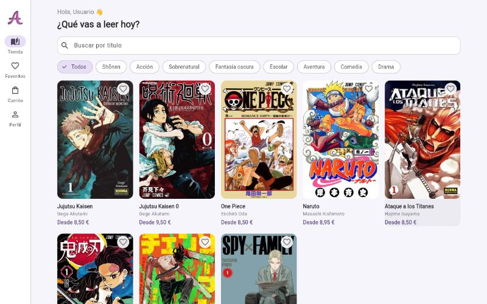
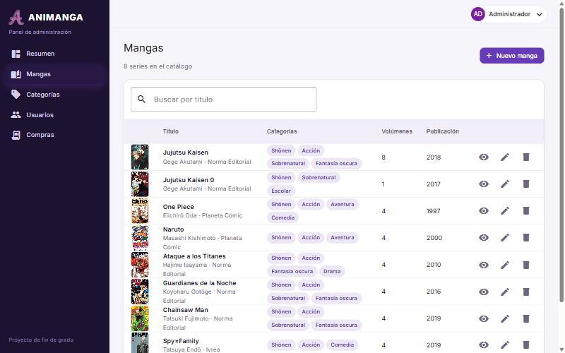
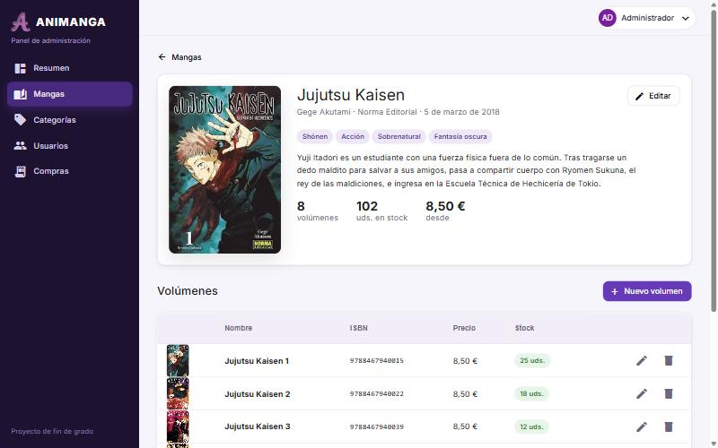

# Animanga

Tienda online de manga desarrollada como **Trabajo de Fin de Grado** y revisada en 2026 para dejarla lista para portfolio.

El proyecto se compone de tres aplicaciones que comparten una API REST:

| Parte | Tecnología | Para quién |
|---|---|---|
| [`develop-api`](develop-api) | Java 17 · Spring Boot 2.7 · Spring Security + JWT · JPA | Backend y base de datos |
| [`develop-web`](develop-web) | Angular 16 · Angular Material | **Panel de administración** (catálogo, usuarios, ventas) |
| [`develop-mobile/animangav5frontend`](develop-mobile/animangav5frontend) | Flutter 3 · Dart 3 · BLoC (Cubit) | **App de compra** para clientes (Android, iOS y web) |


| App cliente (Flutter) | Ficha de manga (Flutter) |
|---|---|
|  |  |

| Catálogo en el panel | Volúmenes de un manga |
|---|---|
|  |  |

## Funcionalidades

**App cliente (Flutter)**
- Registro e inicio de sesión con sesión persistente.
- Catálogo con búsqueda por título y filtro por categoría.
- Ficha del manga con volúmenes, stock en tiempo real y personajes.
- Favoritos sincronizados con el servidor.
- Carrito con cantidades y control de stock.
- Pago con tarjeta **simulado**: valida el número (algoritmo de Luhn), descuenta stock y registra el pedido.
- Historial de pedidos y perfil editable (foto, datos y contraseña).
- Diseño adaptable: barra inferior en móvil y navegación lateral en pantallas anchas.

**Panel de administración (Angular)**
- Resumen con métricas: mangas, volúmenes, stock, usuarios, ingresos, últimas ventas y alertas de stock bajo.
- CRUD de mangas y volúmenes con subida de portadas y vista previa.
- CRUD de categorías.
- Gestión de usuarios: búsqueda, filtro por rol, editar, eliminar y dar o quitar permisos de administrador.
- Listado de compras con la tarjeta enmascarada.
- Perfil del administrador.

**API**
- Autenticación con JWT y refresh token.
- Autorización por rol (`ADMIN` / `USER`) a nivel de rutas y de servicio.
- Documentación OpenAPI en `/swagger-ui.html`.

## Datos de demostración

La API arranca con un catálogo de ejemplo: **8 series** (Jujutsu Kaisen, Jujutsu Kaisen 0, One Piece, Naruto, Ataque a los Titanes, Guardianes de la Noche, Chainsaw Man y Spy×Family), 33 volúmenes con precio y stock (hay alguno agotado y otros con pocas unidades), 14 personajes, 8 categorías, 3 usuarios y un par de compras. Los datos están en `develop-api/src/main/resources/import.sql` y las portadas en `resources/seed/covers`.

> Las portadas y personajes pertenecen a sus autores y editoriales. Se usan solo con fines demostrativos en un proyecto académico sin ánimo de lucro. Los ISBN son ficticios.

## Seguridad

Revisión aplicada sobre la versión original del TFG:

- Reglas de acceso por rol y por método HTTP: un cliente no puede crear, editar ni borrar catálogo, ni ver usuarios o ventas.
- **Sin IDOR**: el carrito, las compras y los perfiles solo son accesibles por su propietario (o por un administrador).
- Las tarjetas **nunca se guardan completas**: se validan y se almacenan enmascaradas (`**** **** **** 4242`).
- El login no revela si un usuario existe.
- Las subidas solo admiten imágenes (detectadas por contenido) y están protegidas contra *path traversal*.
- Los secretos (`JWT_SECRET`, credenciales de la base de datos) llegan por variables de entorno.
- CORS configurable. En producción los frontends llaman a la API a través de un proxy del hosting, así que no se necesita CORS.

## Cuentas de demostración

| Rol | Usuario | Contraseña | Dónde |
|---|---|---|---|
| Administrador | `admin` | `Admin1234` | Panel Angular |
| Cliente | `demo` | `Demo1234` | App Flutter |
| Cliente | `laura` | `Demo1234` | App Flutter |

Tarjeta de prueba: `4242 4242 4242 4242` (cualquier fecha futura y CVC).

## Ejecutar en local

Requisitos: Java 17, Node 18+ y Flutter 3.24+.

```bash
# 1. API (H2 en memoria con datos de ejemplo) → http://localhost:8080
cd develop-api
./mvnw spring-boot:run
```

```bash
# 2. Panel de administración → http://localhost:4200
cd develop-web
npm install
npm start
```

```bash
# 3. App Flutter (web) → abre Chrome
cd develop-mobile/animangav5frontend
flutter pub get
flutter run -d chrome --dart-define=API_URL=http://localhost:8080
```

En el emulador de Android la app usa `http://10.0.2.2:8080` por defecto, sin necesidad de `--dart-define`.

> Si el puerto 8080 está ocupado, arranca la API con `PORT=8081` y el panel con `API_URL=http://localhost:8081 npm start`.

Para usar PostgreSQL en local: `cd develop-api && docker compose up --build`.

## Despliegue

Configuración incluida para un despliegue gratuito:

1. **API → Render.** `render.yaml` crea el servicio Docker con el perfil `demo` (H2 en memoria: la demo se regenera en cada arranque y no caduca). Para datos persistentes, usa el perfil `prod` con PostgreSQL (variables `DATABASE_URL`, `DATABASE_USERNAME`, `DATABASE_PASSWORD` y `JWT_SECRET`).
2. **Panel → Netlify**, con *base directory* `develop-web` (lee `develop-web/netlify.toml`).
3. **App Flutter → Netlify**: ejecuta `flutter build web --release` y publica `build/web`.

Los dos frontends llaman a `/api/*` y Netlify lo redirige a la API. Cuando tengas la URL del backend, sustitúyela en `develop-web/netlify.toml` y en `develop-mobile/animangav5frontend/web/_redirects`.

## Tests

```bash
cd develop-api && ./mvnw test                          # arranque del contexto Spring
cd develop-mobile/animangav5frontend && flutter test   # lógica de tarjeta y modelos
```

## Estructura

```
develop-api/        API REST (controllers → services → repositories), seguridad JWT, datos demo
develop-web/        Panel Angular: core/ (auth, servicios, interceptor), pages/, shared/
develop-mobile/     App Flutter: core/ (config, API), data/ (modelos, repositorios), state/ (cubits), ui/
docs/               Capturas y documento original del TFG
```
