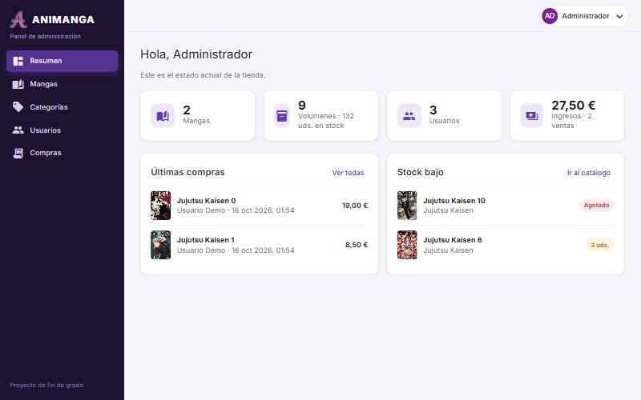
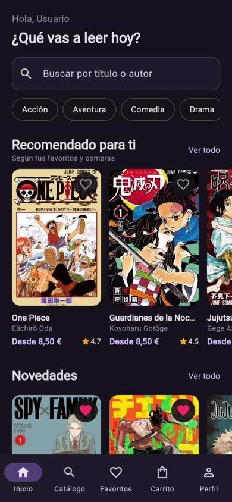
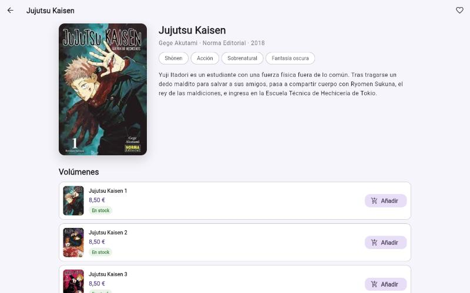
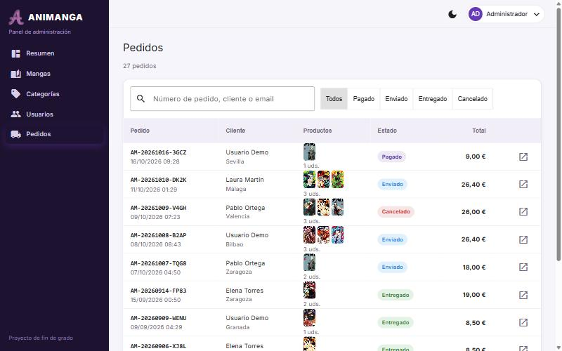

# Animanga


Tienda online de manga desarrollada como **Trabajo de Fin de Grado** y reconstruida en 2026 para dejarla lista para portfolio.

Son tres aplicaciones que comparten una API REST:

| Parte | Tecnología | Para quién |
|---|---|---|
| [`develop-api`](develop-api) | Java 17 · Spring Boot 4.1 · Spring Security 7 + JWT · JPA / Hibernate 7 | Backend |
| [`develop-web`](develop-web) | Angular 16 · Angular Material | **Panel de administración** |
| [`develop-mobile/animangav5frontend`](develop-mobile/animangav5frontend) | Flutter 3 · Dart 3 · BLoC (Cubit) | **Tienda** para clientes (Android, iOS y web) |



| Tienda (Flutter, móvil) | Ficha de manga | Pedidos en el panel |
|---|---|---|
|  |  |  |

## Funcionalidades

### Tienda (Flutter)
- **Se puede navegar sin cuenta.** Solo hay que iniciar sesión para comprar, guardar favoritos o valorar.
- **Portada** con *recomendado para ti* (según tus favoritos y compras), novedades, más vendidos y mejor valorados.
- **Catálogo** con búsqueda por título o autor y filtros por categoría, editorial, precio máximo y disponibilidad. Seis ordenaciones y **scroll infinito**.
- **Ficha** con volúmenes, stock en tiempo real, personajes y **reseñas** con estrellas y sello de *compra verificada*.
- **Buscar por portada**: haz una foto a un tomo (o usa una captura) desde el buscador y la app te dice qué manga es y qué tomo. La API compara la imagen con todas las portadas usando un hash perceptual y un histograma de color; tolera fondos, márgenes, giros y fotos algo torcidas. Es pública pero limitada a 10 búsquedas por minuto.
- **Leer avance como un tomo real**: la página se levanta y gira sobre el lomo con sombra (arrastrando o tocando el borde), orden de lectura japonés (derecha a izquierda) u occidental, doble página en pantallas anchas, zoom, miniaturas y teclado; al final, botón para añadir el tomo al carrito. Las páginas de ejemplo están generadas por código, no son páginas reales.
- **Carrito** y **pago**: dirección de envío, tarjeta validada con el algoritmo de Luhn (pasarela simulada) y confirmación con número de pedido.
- **Mis pedidos** con el seguimiento del estado. Se puede cancelar mientras no se haya enviado.
- **Cuenta**:
  - Registro, verificación de email y recuperación de contraseña.
  - Foto de perfil y edición de datos.
  - Modo claro, oscuro o el del sistema.
- **Detalles técnicos**:
  - La sesión se renueva sola.
  - Las imágenes se guardan en caché.
  - El diseño se adapta: barra inferior en móvil y navegación lateral en pantallas anchas.

### Panel de administración (Angular)
- **Resumen**:
  - Ingresos, pedidos, ticket medio, stock y clientes.
  - **Gráfica de ingresos por mes** (6 o 12 meses) y pedidos por estado.
  - Los más vendidos, los últimos pedidos y el stock bajo.
- **Pedidos**:
  - Búsqueda por número o cliente y filtro por estado.
  - Detalle con la dirección de envío.
  - Cambio de estado (pagado → enviado → entregado, o cancelado con devolución de stock).
- **Catálogo**:
  - Mangas, volúmenes y **personajes**, con portadas y vista previa de la imagen.
  - Filtros y ordenación.
  - Moderación de reseñas.
  - Páginas del avance de cada volumen: subir varias a la vez (hasta 20), reordenar y quitar.
- **Categorías** y **usuarios**: búsqueda, filtro por rol, edición, permisos de administrador y borrado.
- Modo oscuro y diseño adaptable.

### API
- REST con paginación, filtros y ordenación en SQL. El precio *desde*, la valoración media y las ventas se guardan en cada manga para poder ordenar y filtrar en la base de datos.
- Documentación OpenAPI en **`/swagger-ui.html`**.
- Imágenes en disco (desarrollo) o **en la base de datos** (producción), para que sobrevivan a los reinicios de un hosting gratuito.
- Emails por SMTP configurable. Sin SMTP se escriben en el log, para poder probar los flujos en local.

## Seguridad
- **JWT** de corta duración y **refresh token con rotación**: cada renovación invalida el anterior, y en la base de datos solo se guarda su hash.
- **Autorización por rol** en rutas y servicios. Un cliente solo accede a *su* carrito, *sus* pedidos y *su* perfil: nada de IDOR. Si se pide el pedido de otra persona, la API devuelve 404.
- **Límite de intentos de login**: se bloquea tras 5 fallos. El mensaje de error no revela si el usuario existe.
- Al pagar se **bloquean las filas de los volúmenes**, así que dos compras simultáneas no pueden vender la última unidad (lo comprueba un test con varios hilos).
- La tarjeta **nunca se guarda**: solo los 4 últimos dígitos.
- Las imágenes se validan por su contenido real (Apache Tika) y la API está protegida contra *path traversal*.
- Los tokens de verificación y de recuperación son de un solo uso, caducan y se guardan solo como hash.
- Los secretos llegan por variables de entorno. En producción los frontends hablan con la API a través de un proxy del hosting, así que no hace falta abrir CORS.

## Calidad
- **51 tests** en la API (integración con MockMvc y unitarios): autenticación, permisos por rol, catálogo, carrito, pedidos, concurrencia, reseñas y estadísticas.
- **7 tests** en Flutter (validación de tarjeta, modelos y filtros), además de `flutter analyze` sin avisos.
- **CI en GitHub Actions** en cada push: tests de la API, build del panel, análisis y tests de Flutter, y generación del **APK de Android** y de la versión web, que se pueden descargar como *artifacts*.

## Cuentas de demostración

| Rol | Usuario | Contraseña |
|---|---|---|
| Administrador (panel) | `admin` | `Admin1234` |
| Cliente (tienda) | `demo` | `Demo1234` |
| Otros clientes | `laura`, `carlos`, `marta`, `javier`, `sofia`, `pablo`, `elena` | `Demo1234` |

Tarjeta de prueba: `4242 4242 4242 4242`, con cualquier fecha futura y cualquier CVC.

Al arrancar se cargan 8 series (Jujutsu Kaisen, One Piece, Naruto, Ataque a los Titanes, Guardianes de la Noche, Chainsaw Man, Spy×Family…), 33 volúmenes, 14 personajes, reseñas y 26 pedidos repartidos en los últimos 6 meses.

> Las portadas y los personajes pertenecen a sus autores y editoriales. Se usan solo con fines demostrativos en un proyecto académico sin ánimo de lucro. Los ISBN son ficticios.

## Ejecutar en local

Requisitos: Java 17, Node 18+ y Flutter 3.24+.

```bash
# 1. API (H2 en memoria con los datos de ejemplo) → http://localhost:8080
cd develop-api
./mvnw spring-boot:run
```

```bash
# 2. Panel de administración → http://localhost:4200
cd develop-web
npm install
npm start
```

```bash
# 3. Tienda Flutter en el navegador
cd develop-mobile/animangav5frontend
flutter pub get
flutter run -d chrome --dart-define=API_URL=http://localhost:8080
```

En el emulador de Android la app usa `http://10.0.2.2:8080` por defecto.

> Si el puerto 8080 está ocupado: `PORT=8081 ./mvnw spring-boot:run` y `API_URL=http://localhost:8081 npm start`.

Los enlaces de los emails (verificar cuenta y recuperar contraseña) aparecen en el log de la API cuando no hay SMTP configurado.

Con PostgreSQL: `cd develop-api && docker compose up --build`.

### Tests

```bash
cd develop-api && ./mvnw test
cd develop-mobile/animangav5frontend && flutter analyze && flutter test
```

## Despliegue

1. **API en Render.** `render.yaml` crea el servicio Docker.
   - Por defecto usa el perfil `demo`: H2 en memoria, gratis y sin caducidad, con la demo regenerándose en cada arranque.
   - Para datos persistentes usa el perfil `prod` con PostgreSQL (variables `DATABASE_URL`, `DATABASE_USERNAME`, `DATABASE_PASSWORD`). En ese perfil las imágenes se guardan en la base de datos.
2. **Panel en Netlify** con *base directory* `develop-web`. La configuración está en `develop-web/netlify.toml`.
3. **Tienda en Netlify**: publica `build/web`, generado con `flutter build web --release` o descargado de los *artifacts* de CI.

Los dos frontends llaman a `/api/*` y Netlify lo redirige a la API. Cuando tengas la URL del backend, cámbiala en `develop-web/netlify.toml` y en `develop-mobile/animangav5frontend/web/_redirects`.

| Variable | Para qué |
|---|---|
| `JWT_SECRET` | Firma de los tokens (mínimo 32 caracteres). **Obligatoria** en `demo` y `prod`. |
| `FRONTEND_URL` | URL pública de la tienda, para los enlaces de los emails. |
| `SPRING_MAIL_HOST`, `SPRING_MAIL_USERNAME`, `SPRING_MAIL_PASSWORD` | SMTP opcional (Brevo, Resend, Gmail…). |
| `CORS_ALLOWED_ORIGINS` | Solo si un frontend llama a la API sin proxy. |
| `STORAGE_TYPE` | `filesystem` o `database`. |

## Estructura

```
develop-api/       Spring Boot: user/ catalog/ cart/ order/ review/ stats/ storage/ security/ seed/
develop-web/       Angular: core/ (auth, servicios, interceptor, tema), pages/, shared/ (gráficas, diálogos)
develop-mobile/    Flutter: core/ (API, config, tema), data/ (modelos, repositorios), state/ (cubits), ui/
docs/              Capturas y documento original del TFG
```
